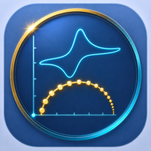
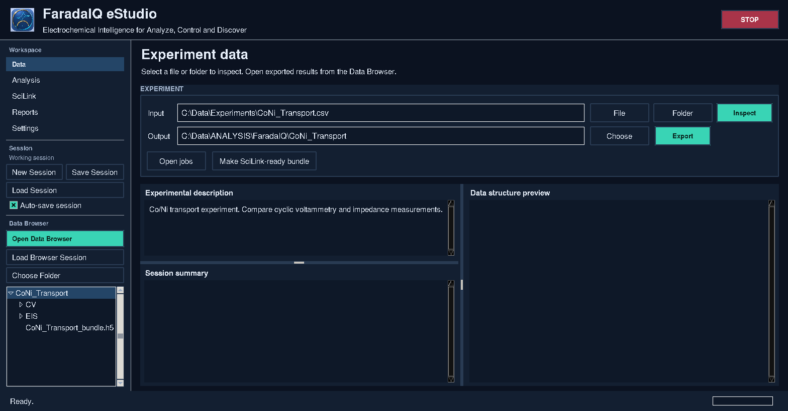
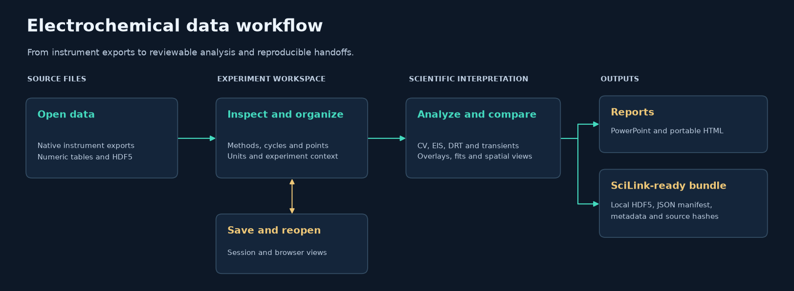
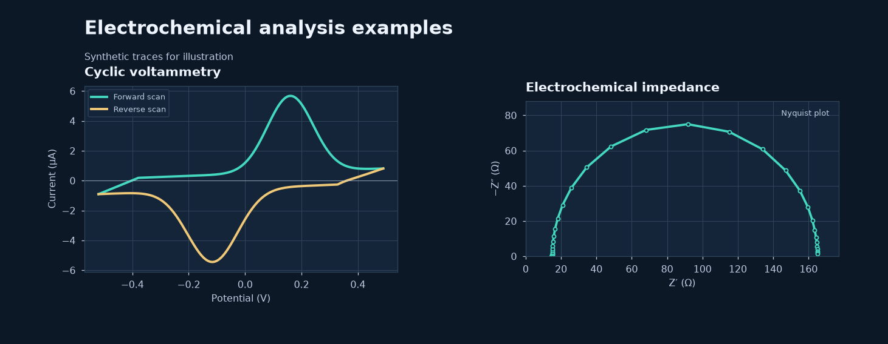
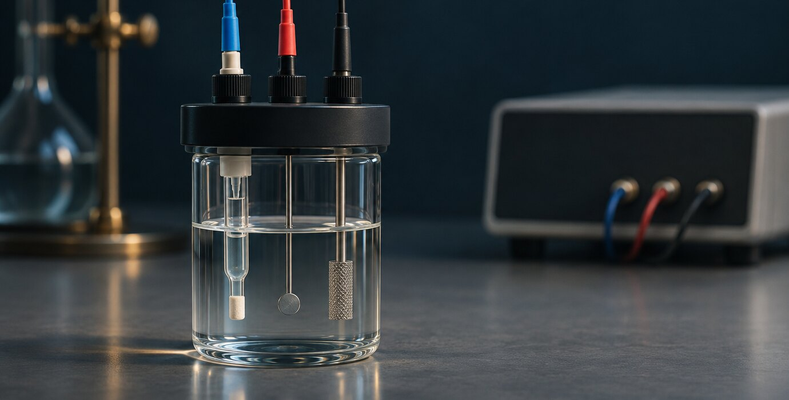

<p align="center"></p>
<h1 align="center">FaradaIQ eStudio</h1>
<p align="center"><strong>A desktop workspace for electrochemical data analysis</strong></p>
<p align="center"><a href="https://github.com/venky-pnnl/FaradaiQ_eStudio/releases">Download</a> · <a href="#install-and-start">Install</a> · <a href="#supported-instrument-files">File formats</a> · <a href="#scientific-analysis">Analysis tools</a> · <a href="#configure-integrations">Integrations</a> · <a href="#how-to-cite">Cite</a> · <a href="#project-credits">Credits</a></p>

Open instrument exports, compare measurements across samples and cycles, and save the session so you can pick up where you left off. eStudio brings CV, EIS, transients, and spatial electrochemistry into the same Data Browser. Export figures and reports or package selected data and experiment metadata for SciLink.



## From source files to results



1. Open a file or folder in **Data** and select **Inspect** to check the techniques, units, and measurement counts.
2. Use the **Data Browser** to find measurements by site, method, or cycle. Overlay selected traces and open the analysis tools for that technique.
3. Use **Save Session** or save a browser session to reopen the experiment or view later. Export a PowerPoint summary or a portable HTML data browser to review results outside the app.

**Make SciLink-ready bundle** writes a local HDF5 file with curated numerical data, a JSON manifest, source files and hashes, and an electrochemistry skill and request template. Open **Ask SciLink** when you want to review a question and choose the files to submit.

## Supported instrument files

| Software | Files | Open in eStudio |
|---|---|---|
| [HEKA](https://www.heka.com/downloads/downloads_main.html) POTMASTER / PATCHMASTER DAT2 | `.dat` and companion sections such as `.pul`, `.pgf`, `.amp`, `.mrk`, `.mth`, and `.onl` | Select the bundled `.dat` or the folder containing the associated files. Keep position files for spatial analysis. |
| [PalmSens](https://www.palmsens.com/software/ps-trace/) PSTrace | `.pssession` | Select a session file, a folder, or a supported ZIP of sessions. |
| [BioLogic](https://www.biologic.net/softwares/ec-lab-software/) EC-Lab | `.mpr`, `.mps`, `.mgr` | Keep the binary data and method files together. |
| [Princeton Applied Research](https://www.ameteksi.com/Products/Software/Princeton-Applied-Research/VersaStudio-Software) VersaStudio | `.par`, with the same-stem `.par.psbd` where present | Open the `.par` with its binary companion beside it. The companion can hold the numerical traces. |
| [Solartron Analytical](https://www.scribner.com/software/) CorrWare / ZPlot | `.cor`, `.z` | Open the original files with their headers intact. |
| Delimited tables | `.csv`, `.tsv`, `.txt`, `.asc` | Use recognizable headers such as `time_s`, `potential_V`, `current_A`, `frequency_Hz`, `Zreal_ohm`, and `Zimag_ohm`. |
| FaradaIQ bundles | `.h5`, `.hdf5` | Open the existing bundle from the Data Browser. |

## Scientific analysis

| Measurement | What you can do |
|---|---|
| CV and LSV | Overlay sweeps, compare cycles, and inspect peaks and baselines. Send selected CV data to PySimpleEChem. |
| EIS and DRT | Compare Nyquist and Bode plots. Review relaxation-time distributions or hand off selected spectra to DearEIS or pyDRTtools. |
| CA, CP, and OCP | Compare current and potential transients. Inspect integrated CA charge and compare OCP over time or by position. |
| Tafel and corrosion | Select polarization ranges for fitting and review corrosion metrics with the fitting range and normalization in view. |
| Mott–Schottky | Examine capacitance as a function of potential when the EIS data include associated potentials. |
| Spatial and SECCM | Group traces by point, method, and cycle. Compare line scans and maps when position metadata are available. |



## Install and start

Download the full `FaradaIQ_eStudio_v331_package.zip` from [GitHub Releases](https://github.com/venky-pnnl/FaradaiQ_eStudio/releases). The matching `.zip.sha256` file contains the archive checksum. Keep the extracted files together and stay online while the installer sets up the runtime.

### Windows

1. In File Explorer, right-click the ZIP, choose **Extract All**, and open the extracted folder.
2. Double-click **`Install_FaradaIQ_eStudio_v331.bat`**. Keep the console open while setup verifies the package and prepares the Python environment. If a compatible Python is missing, setup uses WinGet to install Python 3.12.
3. Open **Desktop → Holaris Apps → FaradaIQ eStudio**. The default install folder is `C:\FaradaIQ\eStudio\V331`.

### macOS

1. In Finder, double-click the ZIP and open the extracted folder.
2. Double-click **`Install_FaradaIQ_eStudio_v331.command`**.
3. Keep Terminal open. The installer reuses Python 3.11 or 3.12 with Tk if available. Otherwise, it downloads and verifies the official Python 3.12 package, then installs it. Enter your Mac administrator password if Terminal prompts for it.
4. Open **Desktop → Holaris Apps → FaradaIQ eStudio**. The icon opens Terminal to start eStudio. The default install folder is `~/Applications/FaradaIQ eStudio/V331`.

#### If macOS blocks the installer

1. After the warning appears, click **Done**.
2. Open ** → System Settings → Privacy & Security**. Scroll to **Security** and look for the installer you just tried to open.
3. After verifying the ZIP against the release’s SHA-256 file, click **Open Anyway** and confirm in the next dialog. If the button is missing, try opening the installer again and return to **Privacy & Security**. [Apple’s Gatekeeper instructions](https://support.apple.com/en-us/102445)

> **macOS security disclaimer.** The downloaded eStudio installer is not Apple-notarized. **Open Anyway** creates an exception for the specific installer. Use it only for a copy obtained from an authorized release source whose SHA-256 checksum you have verified. On an organization-managed Mac, follow your organization’s software approval policy.

#### If the icon closes immediately

Open **Terminal**, paste the following command, and press **Return**.

```bash
/bin/bash "$HOME/Applications/FaradaIQ eStudio/V331/Start_FaradaIQ_eStudio_v331.command"
```

For another installed release, use that release’s folder and launcher version. For v331, startup messages are also saved in `~/Library/Logs/FaradaIQ eStudio/startup_v331.log`. If the app still closes, include the last lines of that log when reporting the issue.

## Configure integrations

### Local analysis tools

| Tool | Setup |
|---|---|
| [pyDRTtools](https://github.com/ciuccislab/pyDRTtools) | Run `install_official_pydrttools_optional.bat` on Windows or `install_official_pydrttools_optional.command` on macOS. The upstream GUI requires Qt5. Select an EIS spectrum and choose **Open in pyDRTtools**. |
| [DearEIS](https://vyrjana.github.io/DearEIS/) | Run `install_deareis_optional.bat` on Windows or `install_deareis_optional_macos.command` on macOS. The environment includes [pyimpspec](https://vyrjana.github.io/pyimpspec/). Select EIS data and choose **Analyze EIS with DearEIS**. |
| [PySimpleEChem](https://github.com/kevinsmia1939/PySimpleEChem#readme) | Use the bundled tools and follow the upstream PyQt5 instructions for the optional GUI. Select a CV trace or group and choose **Open in PySimpleEChem**. |

### SciLink

Install the [SciLink CLI](https://github.com/ziatdinovmax/SciLink#readme) and check it with `scilink --help`. If eStudio cannot find it, set **SciLink executable override** in **Settings → LLM settings → Data Sharing**. In **Providers and Services**, set the provider, model, and credentials and use **Ping selected** to test the connection.

### Edison Scientific

Create a key in your [Edison Scientific profile](https://platform.edisonscientific.com/profile). Under **Settings → LLM settings → Data Sharing**, enter it in **Edison API key (session only)** and apply the settings. Leave **Legacy custom upload URL** blank for the standard client. Open **Ask Edison Scientific** to review the prompt and files before submitting. [Client documentation](https://github.com/EdisonScientific/edison-client-docs#readme)

### LabRIC MCP

Enter your [LabRIC](https://docs.labric.co/welcome) MCP endpoint and session-only key under **Settings → LLM settings → Data Sharing**. Use **Test LabRIC MCP connection**, then enable **Use LabRIC MCP cloud context** if you want SciLink to query authorized LabRIC data.

## How to cite

Use the version that produced the results reported in your article. For v331, the software reference in APA style is:

> Prabhakaran, V. (2026). *FaradaIQ eStudio* (Version v331) [Computer software]. <https://github.com/venky-pnnl/FaradaiQ_eStudio>

**Methods example.** “Electrochemical data were processed using FaradaIQ eStudio v331 (Prabhakaran, 2026).”

Add the versions of any third-party tools used and cite the applicable methods below. The repository’s [citation file](CITATION.cff) contains the software metadata that GitHub uses to provide APA and BibTeX export.

## Funding acknowledgment

Development of FaradaIQ eStudio was supported by the [Non-Equilibrium Transport Driven Separations Initiative (NETS)](https://www.pnnl.gov/projects/nets) through the Laboratory Directed Research and Development (LDRD) Program at Pacific Northwest National Laboratory (PNNL).

## Project credits

FaradaIQ eStudio was designed by Venkateshkumar Prabhakaran.

| Project | Contributors and role | Citation |
|---|---|---|
| pySECCM parsing and plotting tools | Benjamin A. Helfrecht (PNNL) designed the original SECCM parser. eStudio includes that parser and the accompanying plotting tools. | Helfrecht, B. A. (n.d.). *pySECCM parsing and plotting tools* [Computer software]. [Bundled parser notes](pyseccm_tools/README-CV) |
| [pyDRTtools](https://github.com/ciuccislab/pyDRTtools) | Ciucci Lab, Francesco Ciucci, Adeleke Maradesa, and contributors. Distribution of relaxation times (DRT) analysis. | [Wan et al. (2015), radial basis functions](https://doi.org/10.1016/j.electacta.2015.09.097), [Ciucci & Chen (2015), Bayesian DRT](https://doi.org/10.1016/j.electacta.2015.03.123), or [Maradesa et al. (2023), regularization](https://doi.org/10.1149/1945-7111/acbca4), according to the method used. |
| [DearEIS](https://github.com/vyrjana/DearEIS) and [pyimpspec](https://github.com/vyrjana/pyimpspec) | Ville Yrjänä and contributors. Impedance analysis and equivalent-circuit workflows. | [Yrjänä (2022), DearEIS](https://doi.org/10.21105/joss.04808). If using pyimpspec directly, cite its software version. |
| [PySimpleEChem](https://github.com/kevinsmia1939/PySimpleEChem) | Kavin Teenakul and contributors. Cyclic voltammetry visualization and analysis. | [PySimpleEChem software repository](https://github.com/kevinsmia1939/PySimpleEChem). Include the version or commit used. |
| [SciLink](https://github.com/ziatdinovmax/SciLink) | Maxim Ziatdinov and the PNNL SciLink team. Scientific analysis, literature review, and planning. [PNNL project page](https://www.pnnl.gov/projects/center-robotics-autonomy/scilink) | [Yao et al. (2025), SciLink preprint](https://arxiv.org/abs/2508.06569) |
| [Edison Scientific](https://platform.edisonscientific.com/) | Edison Scientific team. Scientific and literature analysis through the official client. | [Edison Scientific client documentation](https://github.com/EdisonScientific/edison-client-docs). Identify the service, agent, and client version if used. |
| [impedance.py](https://github.com/ECSHackWeek/impedance.py) | ECSHackWeek contributors. Electrochemical impedance analysis. | [Murbach et al. (2020), impedance.py](https://doi.org/10.21105/joss.02349) |

Open **Credits** in eStudio for project links and setup guides. See the [full references and third-party notices](docs/THIRD_PARTY.md) for citation details, attribution, licenses, and service terms.


