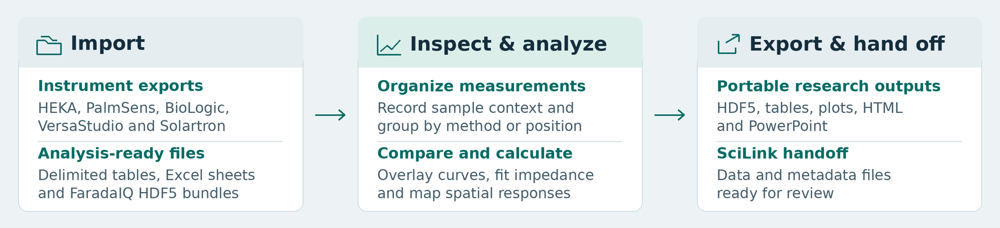
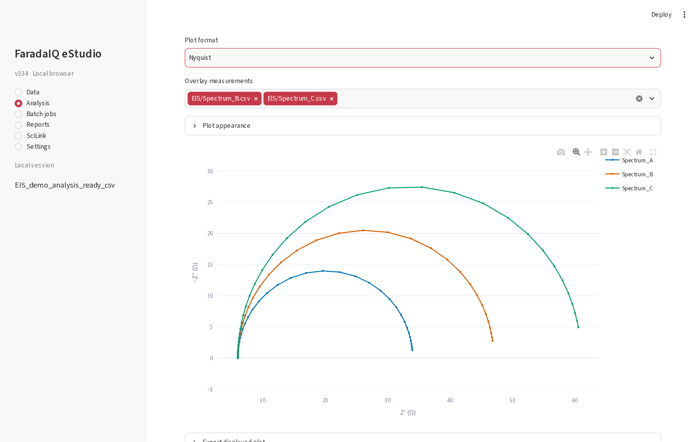

# FaradaIQ eStudio

**A local workspace for electrochemical data from instrument export to research-ready results.**

Open data from HEKA, PalmSens, BioLogic, VersaStudio, and Solartron, alongside delimited tables, Excel worksheets, and FaradaIQ HDF5 bundles. Use one workflow to inspect measurements, compare traces, run technique-specific analyses, and package the results for a report, a collaborator, or SciLink.

[Download](https://github.com/venky-pnnl/FaradaiQ_eStudio/releases) · [Install](docs/workflows.md#install-and-start) · [Supported formats](docs/workflows.md#supported-instrument-files) · [Analysis methods](docs/workflows.md#scientific-analysis) · [SciLink handoff](docs/workflows.md#send-a-bundle-to-scilink-streamlit)

## From source files to results

1. **Import and inspect.** Open a native file or experiment folder with its instrument companion files. In the measurement catalog, review units and record the sample name, session ID, and experimental notes.
2. **Compare and analyze.** Overlay compatible traces or group measurements by technique, point, or cycle. Run methods for voltammetry, chronoamperometry and chronopotentiometry, open-circuit potential, impedance and DRT, corrosion, Mott–Schottky, or SECCM.
3. **Export and share.** Export tables and plots, a canonical HDF5 bundle, a portable HTML report, or a PowerPoint summary. A SciLink-ready export pairs the HDF5 data with experiment metadata for review and upload. [See the step-by-step workflow and method demos](docs/workflows.md)

## Example · Compare impedance spectra

View one eStudio Browser screenshot

*Three synthetic spectra shown in eStudio Browser. The same workspace supports equivalent-circuit fitting, impedance validation, and distribution of relaxation times.*

## Start working

The Windows and macOS installers set up eStudio, check and install DearEIS and pyDRTtools, and check managed SciLink before opening the apps. Use the main installer for a fresh installation or to retry a tool that could not be set up. Find all three shortcuts under **Desktop → Holaris Apps**. Imports, plots, deterministic analyses, and reports run locally. When you submit a reviewed SciLink or Edison request, the selected files can go to the configured service.

- **Windows** · Run `Install_FaradaIQ_eStudio_v336.bat`. [Windows installation](docs/workflows.md#windows)
- **macOS** · Run `Install_FaradaIQ_eStudio_v336.command`. [macOS installation](docs/workflows.md#macos)
- **SciLink** · Setup checks the official SciLink GitHub repository and installs SciLink in a separate Python environment. Use **Update SciLink** in either eStudio interface to refresh it and open the browser. [Managed installation and handoff](docs/workflows.md#scilink)

## Cite and credit

Prabhakaran, V. (2026). *FaradaIQ eStudio* (Version v336) [Computer software]. [Software citation](CITATION.cff)

Venkateshkumar Prabhakaran designed FaradaIQ eStudio. Benjamin A. Helfrecht (PNNL) designed the original SECCM parser. Development was supported by the Non-Equilibrium Transport Driven Separations Initiative (NETS) through PNNL’s Laboratory Directed Research and Development (LDRD) Program. [Project credits and method citations](docs/workflows.md#project-credits) · [NETS](https://www.pnnl.gov/projects/nets)
