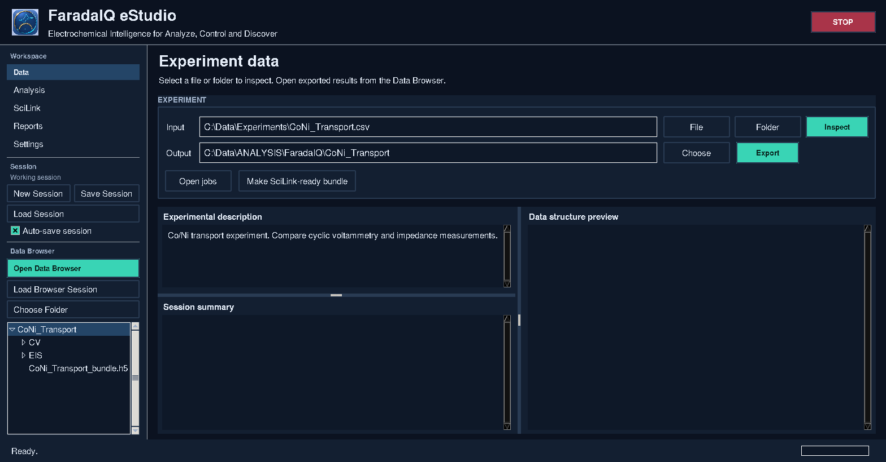
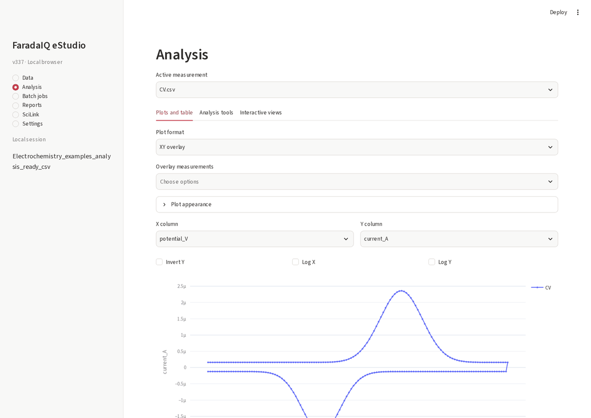
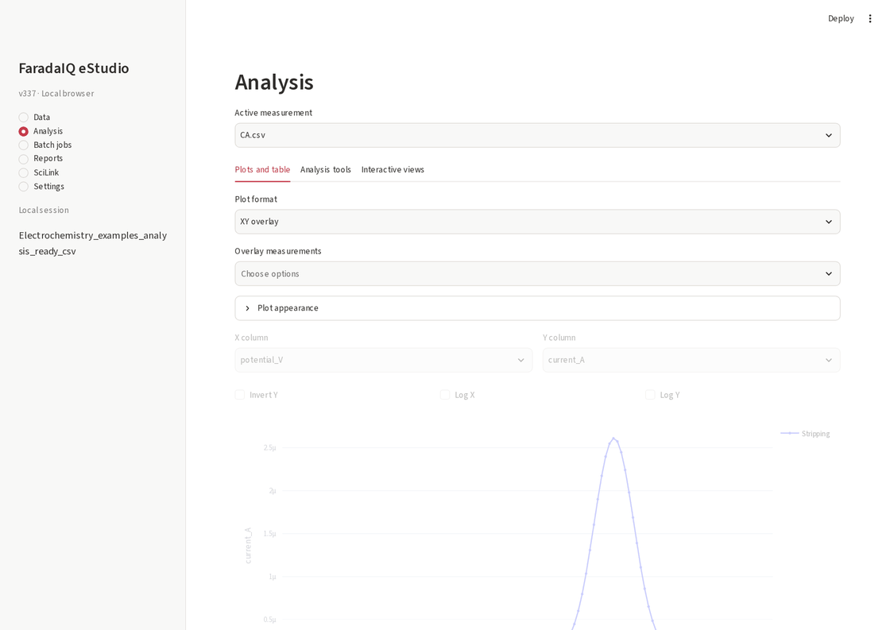
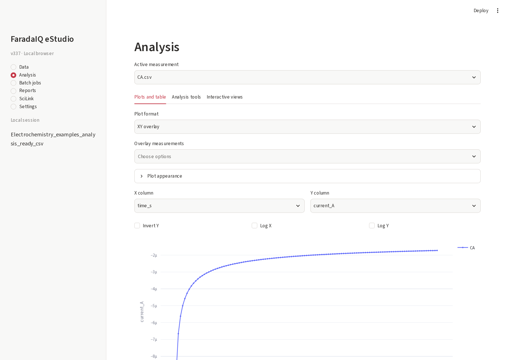
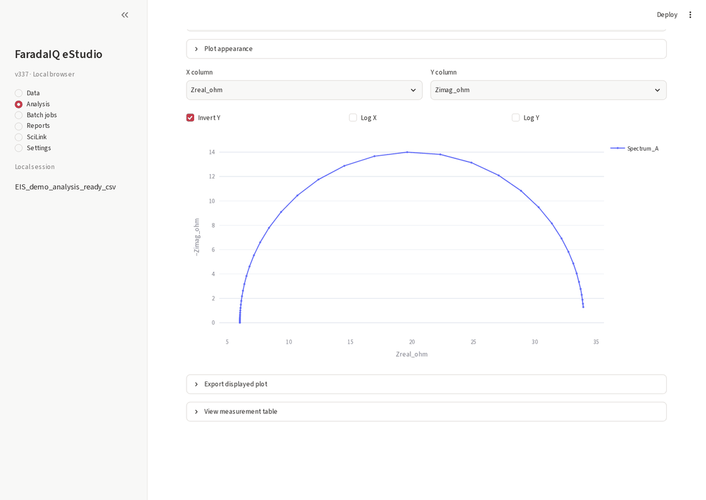
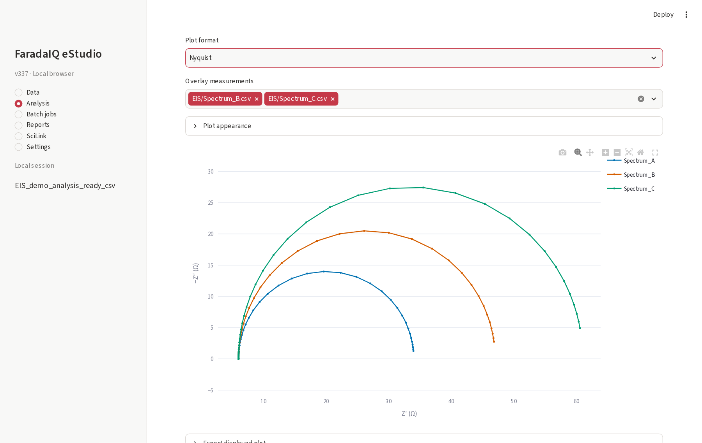
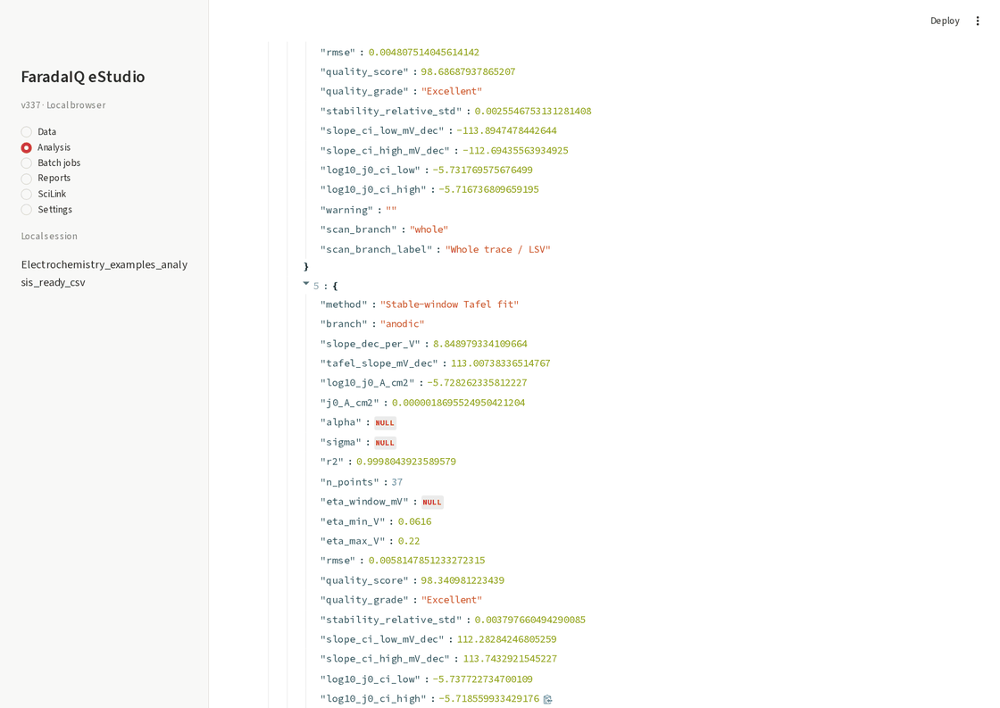
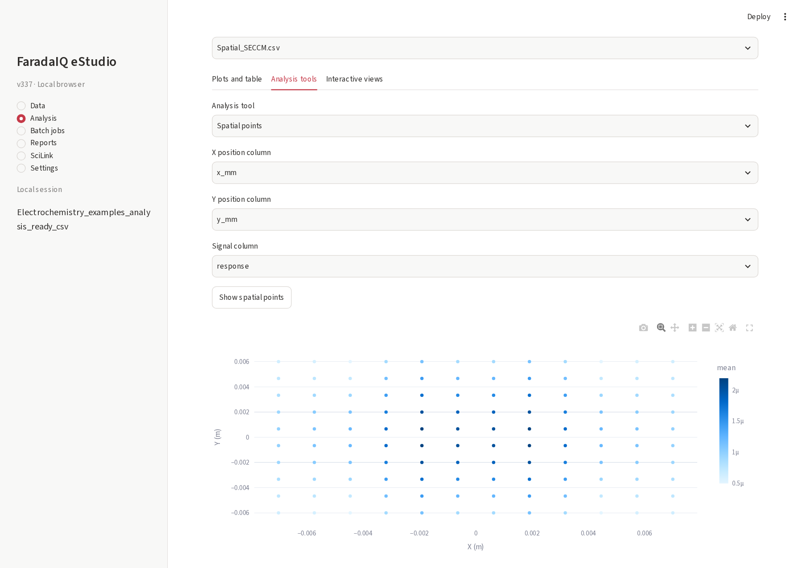
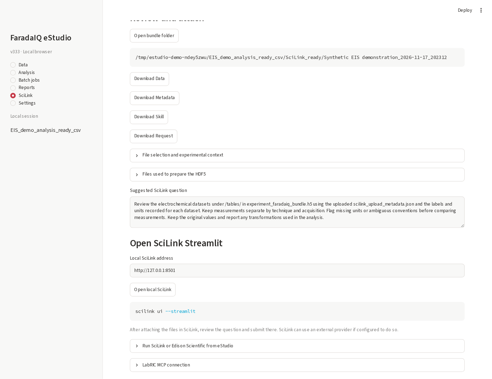
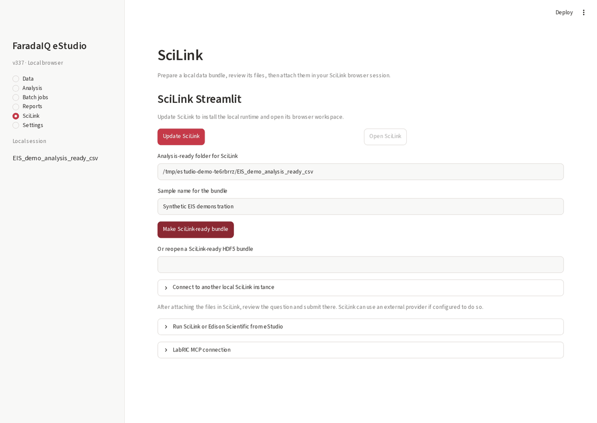

# FaradaIQ eStudio workflow guide

[Project overview](../README.md) · [Install](#install-and-start) · [File formats](#supported-instrument-files) · [Analysis methods](#scientific-analysis) · [SciLink handoff](#send-a-bundle-to-scilink-streamlit)

## Workflows

| Start here | Use it for |
|---|---|
| **FaradaIQ eStudio** | Desktop analysis, saved plot layouts, and optional native tool windows. |
| **FaradaIQ eStudio Browser** | Open experiments, analyze and compare traces, export data and reports, and prepare or run reviewed service requests. [Start the browser](#local-browser). |

### Analyze measurements in the desktop app

1. In **Data**, select an instrument file or experiment folder and use **Inspect** to check measurement counts and units. Keep instrument companion files together.
2. Open **Data Browser** to group measurements by point, method, or cycle, overlay traces, and open technique-specific analysis tools.
3. Use **Save Session** to keep your work. Open **Reports** for a PowerPoint summary or portable HTML data browser.



### Analyze measurements in the local browser

1. In **Data**, choose files or a folder, or enter a local path. Select **Open data**, then search or filter the measurement catalog. Save the sample, session ID, and notes under **Experiment context**.
2. In **Analysis**, choose a measurement. Use **Plots and table** to set axes, display Nyquist or Bode plots, overlay traces, or export the plotted values. Open **Analysis tools** for method-specific settings and **Interactive views** for 2D, 3D, and hyperspectral views when the data include the required coordinates.
3. Use **Data → Open or save a session** to keep the experiment context and plot choices. Use **Batch jobs** to configure, save, and resume an export queue. In **Reports**, export canonical HDF5, portable HTML, or a PowerPoint summary.

To continue in SciLink, prepare a local HDF5 bundle in either mode. [Follow the SciLink handoff](#send-a-bundle-to-scilink-streamlit).

## Supported instrument files

| Software | Files | Open in eStudio |
|---|---|---|
| [HEKA](https://www.heka.com/downloads/downloads_main.html) POTMASTER / PATCHMASTER DAT2 | `.dat` and companion sections such as `.pul`, `.pgf`, `.amp`, `.mrk`, `.mth`, and `.onl` | Select the bundled `.dat` or the folder containing the associated files. Keep position files for spatial analysis. |
| [PalmSens](https://www.palmsens.com/software/ps-trace/) PSTrace | `.pssession` | Select a session file, a folder, or a supported ZIP of sessions. |
| [BioLogic](https://www.biologic.net/softwares/ec-lab-software/) EC-Lab | `.mpr`, `.mps`, `.mgr` | Keep the binary data and method files together. |
| [Princeton Applied Research](https://www.ameteksi.com/Products/Software/Princeton-Applied-Research/VersaStudio-Software) VersaStudio | `.par`, with the same-stem `.par.psbd` where present | Open the `.par` with its binary companion beside it. The companion can hold the numerical traces. |
| [Solartron Analytical](https://www.scribner.com/software/) CorrWare / ZPlot | `.cor`, `.z` | Open the original files with their headers intact. |
| Delimited tables | `.csv`, `.tsv`, `.txt`, `.asc` | Use recognizable headers such as `time_s`, `potential_V`, `current_A`, `frequency_Hz`, `Zreal_ohm`, and `Zimag_ohm`. |
| Excel | `.xlsx`, `.xls` | Read the first worksheet. The SciLink export retains the original workbook alongside its extracted values. |
| FaradaIQ bundles | `.h5`, `.hdf5` | Open a bundle through **Data**. The browser catalog shows tables, metadata, and packaged media. |

## Scientific analysis

Choose the relevant **Analysis tool** in the v338 local browser. The table also shows where to find the corresponding desktop workflows.

| Measurement | Local browser | Desktop app |
|---|---|---|
| **CV, LSV, FSCV** | Choose **Voltammetry and transients**, then **Calculate trace metrics**. **CV peaks and baselines** adds branch metrics and PySimpleEChem analysis. | Compare sweeps and cycles, inspect branches and baselines, and open selected CV data in PySimpleEChem. |
| **DPV, SWV, NPV, and stripping** | Select the technique under **Voltammetry and transients** and calculate metrics from the recorded potential and current. | Inspect and compare pulse and stripping traces and use the technique-specific tools available for the dataset. |
| **CA, CP, OCP, and deposition** | Choose the technique under **Voltammetry and transients**. Review integrated charge when current is recorded, potential transients, or the final-time OCP statistics. | Inspect time-series data, review charge and transients, or compare OCP by position. |
| **EIS and DRT** | Choose **EIS and DRT** and select a circuit fit, linear Kramers–Kronig validation, DRT, or a DearEIS handoff. Select **Run analysis**. Configure simple, Bayesian, or Bayesian Hilbert transform DRT. Output includes calculated spectra, selected figures, and settings files. | Compare Nyquist and Bode views, configure DRT runs, and open selected spectra in DearEIS or pyDRTtools. |
| **Tafel and corrosion** | Choose **Tafel and corrosion** to set Tafel ranges, reference potential, or corrosion criteria. Review the fit and download the result files. | Set fitting ranges and inspect polarization, normalization, and corrosion diagnostics. |
| **Mott–Schottky** | Choose **Mott–Schottky** for impedance measured across DC potential steps on a common frequency grid. | Review potential-dependent impedance, capacitance, fits, and related views. |
| **Spatial and SECCM** | Choose **Spatial points** for point metrics or **Interactive views** for 2D maps, 3D surfaces, and hyperspectral views with suitable input. | Group traces by point, method, and cycle. Review line scans, spatial maps, and multidimensional views. |

The recordings below use synthetic measurements and were captured in the v337 local browser.

<details>
<summary>Watch CV, LSV, FSCV, pulse, and stripping measurements</summary>
<p></p>
</details>

<details>
<summary>Watch CA, CP, OCP, and deposition measurements</summary>
<p></p>
<p></p>
</details>

<details>
<summary>Watch impedance overlays, circuit fitting, lin-KK, and DRT</summary>
<p></p>
<p></p>
</details>

<details>
<summary>Watch Tafel, corrosion, Mott–Schottky, and spatial analysis</summary>
<p></p>
<p></p>
</details>

## Install and start

Download the full `FaradaIQ_eStudio_v338_package.zip` from [GitHub Releases](https://github.com/venky-pnnl/FaradaiQ_eStudio/releases). The matching `.zip.sha256` file contains the archive checksum. Keep the extracted files together and stay online while the installer sets up the runtime. The main installer checks DearEIS, official pyDRTtools, and managed SciLink before opening the apps. Run the same installer again to repair an incomplete tool setup.

### Windows

1. In File Explorer, right-click the ZIP, choose **Extract All**, and open the extracted folder.
2. Double-click **`Install_FaradaIQ_eStudio_v338.bat`**. Keep the console open while setup verifies the package and prepares the Python environment. If a compatible Python is missing, setup uses WinGet to install Python 3.12.
3. Setup opens **FaradaIQ eStudio**, **FaradaIQ eStudio Browser**, and **SciLink**. Reopen any app from **Desktop → Holaris Apps**. The default eStudio install folder is `C:\FaradaIQ\eStudio\V338`.

### macOS

1. In Finder, double-click the ZIP and open the extracted folder.
2. Double-click **`Install_FaradaIQ_eStudio_v338.command`**.
3. Keep Terminal open. The installer reuses Python 3.12 with Tk if available. Otherwise, it downloads and verifies the official Python 3.12 package, then installs it. Enter your Mac administrator password if Terminal prompts for it.
4. Setup opens **FaradaIQ eStudio**, **FaradaIQ eStudio Browser**, and **SciLink**. Reopen any app from **Desktop → Holaris Apps**. The default eStudio install folder is `~/Applications/FaradaIQ eStudio/V338`.

#### If macOS blocks the installer

1. After the warning appears, click **Done**.
2. Open ** → System Settings → Privacy & Security**. Scroll to **Security** and look for the installer you just tried to open.
3. After verifying the ZIP against the release’s SHA-256 file, click **Open Anyway** and confirm in the next dialog. If the button is missing, try opening the installer again and return to **Privacy & Security**. [Apple’s Gatekeeper instructions](https://support.apple.com/en-us/102445)

> **macOS security disclaimer.** The downloaded eStudio installer is not Apple-notarized. **Open Anyway** creates an exception for the specific installer. Use it only for a copy obtained from an authorized release source whose SHA-256 checksum you have verified. On an organization-managed Mac, follow your organization’s software approval policy.

#### If the icon closes immediately

Open **Terminal**, paste the following command, and press **Return**.

```bash
/bin/bash "$HOME/Applications/FaradaIQ eStudio/V338/Start_FaradaIQ_eStudio_v338.command"
```

For another installed release, use that release’s folder and launcher version. For v338, startup messages are also saved in `~/Library/Logs/FaradaIQ eStudio/startup_v338.log`. If the app still closes, include the last lines of that log when reporting the issue.

### Local browser

Open **FaradaIQ eStudio Browser** under **Desktop → Holaris Apps**. Its local server runs in the background. It uses `http://127.0.0.1:8512` when available. The versioned BAT or COMMAND launcher in the installation folder can also run the server in a terminal for diagnostics.

Use a local folder path for large datasets or a mounted network share. The file and folder pickers send selected files to eStudio on the same computer. Keep instrument companions together. When a folder contains both raw instrument files and curated tables, open the curated folder separately to analyze those tables. Imports, plots, deterministic calculations, and reports run on your computer. A reviewed SciLink or Edison request can send selected data to the provider you configure.

The browser launcher records the actual loopback address in the versioned startup log. The desktop app provides its saved native layouts and optional Qt tool windows. The browser provides method-specific controls, interactive charts, and downloadable outputs for the workflows listed under **Scientific analysis**. See the [verification report](../QA_v338.md) for platform and service coverage.

If the browser does not start, check `%LOCALAPPDATA%\FaradaIQ\eStudio\logs\browser_v338.log` on Windows or `~/Library/Logs/FaradaIQ eStudio/browser_v338.log` on macOS.

## Configure integrations

### Local analysis tools

| Tool | Setup |
|---|---|
| [DearEIS](https://vyrjana.github.io/DearEIS/) | The main installer checks DearEIS in a separate Python environment. Select a spectrum and choose **Analyze EIS with DearEIS**. |
| [pyDRTtools](https://github.com/ciuccislab/pyDRTtools) | The main installer checks the official package and its Qt5 GUI prerequisites. Select a spectrum and choose **Open in pyDRTtools**. The bundled eStudio DRT engine is available as part of the core installation. |
| [PySimpleEChem](https://github.com/kevinsmia1939/PySimpleEChem#readme) | Use the bundled tools. Select a CV trace or group and choose **Open in PySimpleEChem** for the optional native interface. |

Setup reports which tools are ready and where to find the diagnostic logs. If an integration fails, use the same main installer to retry.

### SciLink

Setup checks the [official SciLink GitHub repository](https://github.com/ziatdinovmax/SciLink) every time it runs. SciLink lives at `C:\FaradaIQ\SciLink` on Windows or `~/Applications/FaradaIQ SciLink` on macOS, with its own Python environment. Its **SciLink** shortcut under **Desktop → Holaris Apps** starts the standalone Streamlit app using the upstream SciLink logo.

Choose **Update SciLink** in eStudio Desktop or in eStudio Browser's **SciLink** panel. eStudio compares the upstream Git commit to your installed commit, then installs and verifies the new revision when it changes. An unsuccessful installation leaves the previous SciLink revision selected. **Open SciLink** launches the installed version. Setup needs access to GitHub and a Python package index to provision SciLink.

Configure the model and credentials in SciLink for interactive analysis. Reviewed jobs started in eStudio can use the managed installation or an explicit SciLink executable or Python override.

#### Send a bundle to SciLink Streamlit

1. **Prepare.** Open the experiment in either eStudio interface. Select **SciLink → Make SciLink-ready bundle**. eStudio writes the bundle to the local analysis folder.
2. **Review.** Check the file list and experiment context. Select **Open bundle folder** to locate the files. In the local browser, **Download Data** and **Download Metadata** are available for smaller files.
3. **Open SciLink.** Select **Open SciLink** in eStudio or use the **SciLink** shortcut. The launcher opens the actual loopback address in your browser.
4. **Attach and analyze.** In SciLink, choose **Analyze**, attach the files below, and review the attachments before selecting **Analyze**. When chat opens, paste or adapt eStudio’s suggested question.

| eStudio output | Where to attach it in SciLink |
|---|---|
| `experiment_faradaiq_bundle.h5` | **Data file(s)** |
| `scilink_upload_metadata.json` | **Metadata (optional)** |
| `electrochemistry_skill.md` | **Skills → Upload Skills** if you want to include the electrochemistry skill |



<sub>eStudio v337 Browser handoff for the synthetic impedance example.</sub>

<details>
<summary>Watch the SciLink bundle handoff</summary>
<p></p>
</details>

The HDF5 bundle includes curated tables under `/tables/`, recorded units, and original table and metadata documents. The full manifest and request record stay in the local bundle folder. SciLink processes the attachments after you submit them using the provider configured there.

#### Run a reviewed analysis from eStudio Browser

Open **SciLink → Run SciLink or Edison Scientific from eStudio**, choose SciLink or Edison Scientific, and prepare a local review with the exact prompt and selected files. Configure the service and approve the displayed request before selecting **Start reviewed SciLink job** or **Start reviewed Edison Scientific job**. The run folder contains the request and available results and logs. The runner uses the managed SciLink Python when available.

### Edison Scientific

Create a key in your [Edison Scientific profile](https://platform.edisonscientific.com/profile). Under **Settings → LLM settings → Data Sharing**, enter it in **Edison API key (session only)** and apply the settings. Leave **Legacy custom upload URL** blank for the standard client. Open **Ask Edison Scientific** to review the prompt and files before submitting. [Client documentation](https://github.com/EdisonScientific/edison-client-docs#readme)

### LabRIC MCP

Enter your [LabRIC](https://docs.labric.co/welcome) MCP endpoint and session-only key under **Settings → LLM settings → Data Sharing**. Use **Test LabRIC MCP connection**, then enable **Use LabRIC MCP cloud context** if you want SciLink to query authorized LabRIC data. In the browser, open **SciLink → LabRIC MCP connection** to check the HTTPS connection and configure LabRIC for a reviewed SciLink job.

## How to cite

Use the version that produced the results reported in your article. The APA reference for v338 is below.

> Prabhakaran, V. (2026). *FaradaIQ eStudio* (Version v338) [Computer software]. <https://github.com/venky-pnnl/FaradaiQ_eStudio>

**Methods example.** “Electrochemical data were processed using FaradaIQ eStudio v338 (Prabhakaran, 2026).”

Add the versions of any third-party tools used and cite the applicable methods below. The repository’s [citation file](../CITATION.cff) contains the software metadata that GitHub uses to provide APA and BibTeX export.

## Funding acknowledgment

Development of FaradaIQ eStudio was supported by the [Non-Equilibrium Transport Driven Separations Initiative (NETS)](https://www.pnnl.gov/projects/nets) through the Laboratory Directed Research and Development (LDRD) Program at Pacific Northwest National Laboratory (PNNL).

## Project credits

FaradaIQ eStudio was designed by Venkateshkumar Prabhakaran.

| Project | Contributors and role | Citation |
|---|---|---|
| pySECCM parsing and plotting tools | Benjamin A. Helfrecht (PNNL) designed the original SECCM parser. eStudio includes that parser and the accompanying plotting tools. | Helfrecht, B. A. (n.d.). *pySECCM parsing and plotting tools* [Computer software]. [Bundled parser notes](../pyseccm_tools/README-CV) |
| [pyDRTtools](https://github.com/ciuccislab/pyDRTtools) | Ciucci Lab, Francesco Ciucci, Adeleke Maradesa, and contributors. Distribution of relaxation times (DRT) analysis. | [Wan et al. (2015), radial basis functions](https://doi.org/10.1016/j.electacta.2015.09.097), [Ciucci & Chen (2015), Bayesian DRT](https://doi.org/10.1016/j.electacta.2015.03.123), or [Maradesa et al. (2023), regularization](https://doi.org/10.1149/1945-7111/acbca4), according to the method used. |
| [DearEIS](https://github.com/vyrjana/DearEIS) and [pyimpspec](https://github.com/vyrjana/pyimpspec) | Ville Yrjänä and contributors. Impedance analysis and equivalent-circuit workflows. | [Yrjänä (2022), DearEIS](https://doi.org/10.21105/joss.04808). If using pyimpspec directly, cite its software version. |
| [PySimpleEChem](https://github.com/kevinsmia1939/PySimpleEChem) | Kavin Teenakul and contributors. Cyclic voltammetry visualization and analysis. | [PySimpleEChem software repository](https://github.com/kevinsmia1939/PySimpleEChem). Include the version or commit used. |
| [SciLink](https://github.com/ziatdinovmax/SciLink) | Maxim Ziatdinov and the PNNL SciLink team (PNNL contact: Sarah Allec). Scientific analysis, literature review, and planning. [PNNL project page](https://www.pnnl.gov/projects/center-robotics-autonomy/scilink) | [Yao et al. (2025), SciLink preprint](https://arxiv.org/abs/2508.06569) |
| [Edison Scientific](https://platform.edisonscientific.com/) | Edison Scientific team. Scientific and literature analysis through the official client. | [Edison Scientific client documentation](https://github.com/EdisonScientific/edison-client-docs). Identify the service, agent, and client version if used. |
| [impedance.py](https://github.com/ECSHackWeek/impedance.py) | ECSHackWeek contributors. Electrochemical impedance analysis. | [Murbach et al. (2020), impedance.py](https://doi.org/10.21105/joss.02349) |
| [galvani](https://github.com/echemdata/galvani) | echemdata contributors. Electrochemical file support. | Cite the software version used. |
| [Scientific Python](https://scientific-python.org/) | NumPy, SciPy, pandas, and Matplotlib communities. Arrays, numerical methods, tables, and plots. | Cite the libraries used in the analysis. |
| [HDF5 / h5py](https://www.h5py.org/) | The HDF Group and h5py contributors. Structured data and metadata storage. | Cite the software if relevant to the workflow. |
| Desktop, browser, and reporting tools | Tcl/Tk, Streamlit, Pillow, Plotly, Altair, python-pptx, and openpyxl communities. User interfaces, graphics, and scientific reports. | [Third-party notices](THIRD_PARTY.md) |

Open **Credits** in eStudio for project links and setup guides. See the [full references and third-party notices](THIRD_PARTY.md) for citation details, attribution, licenses, and service terms.
